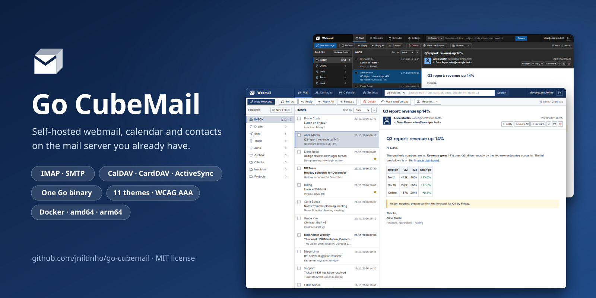
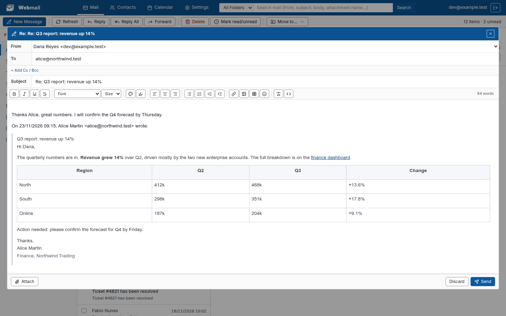
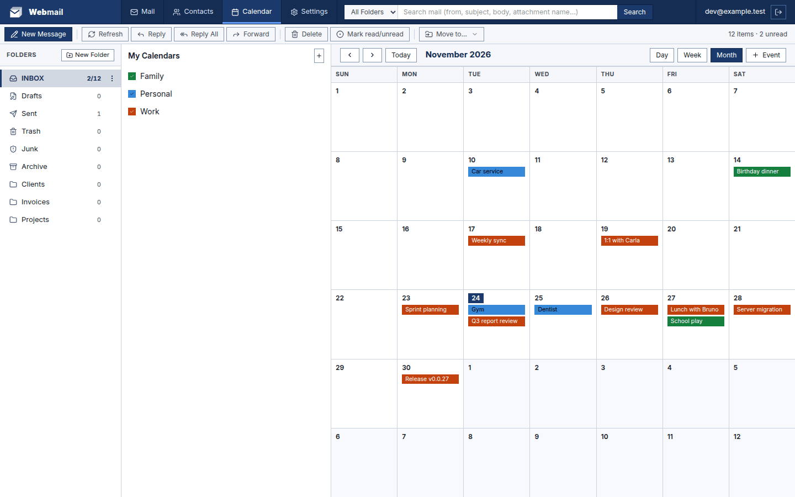
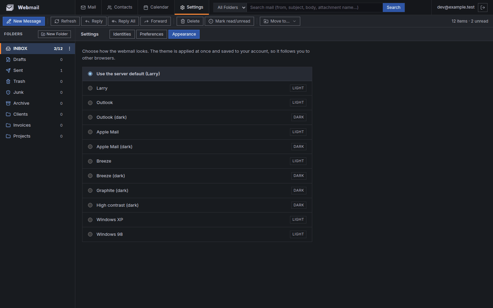

<p align="center">
  
</p>

# Go CubeMail

[](https://github.com/jniltinho/go-cubemail/releases)
[](https://github.com/jniltinho/go-cubemail/pkgs/container/go-cubemail)
[](https://go.dev/)
[](./LICENSE)
[](https://github.com/jniltinho/go-cubemail/stargazers)

**The webmail your mail server is missing.** One small binary gives your users a modern inbox, a calendar and an
address book, and keeps all three in sync with their phones and desktop clients. Nothing to migrate: it talks to the
IMAP and SMTP server you already run, and your messages never leave it.

## Why Go CubeMail

- **Keep your mail server.** Dovecot, Cyrus, Exchange over IMAP or any other IMAP/SMTP server. No mailbox import, no
  second copy of the mail.
- **One binary, no stack to maintain.** The Vue interface is compiled into the Go executable. No PHP, no Node.js, no
  separate web server; SQLite by default, MariaDB or PostgreSQL when you want them.
- **Calendar and contacts that reach every device.** Built-in CalDAV, CardDAV and Exchange ActiveSync servers: Apple
  Calendar, Thunderbird, Outlook, iOS and Android sync natively, with the same data the web interface shows.
- **A look for everyone.** Eleven themes, from the classic Larry to Outlook and Apple Mail styles, dark themes, a
  high-contrast one and two for the nostalgic. Every one meets WCAG AAA contrast, and each user picks their own.
- **Ready for big screens.** The whole interface scales up on QHD and 4K monitors.
- **Private by design.** Mail stays on your IMAP server. The database holds only contacts, calendars, identities,
  settings and sessions.
- **Free and open.** MIT licensed, with a documented REST API.

## Try it in a minute

```bash
docker run -d --name go-cubemail -p 8080:8080 \
  -e GORC_SERVER_SECRET_KEY="$(openssl rand -base64 24)" \
  -e GORC_IMAP_HOST=mail.example.com \
  -e GORC_SMTP_HOST=mail.example.com \
  -v go-cubemail-data:/data \
  ghcr.io/jniltinho/go-cubemail:latest
```

Open http://localhost:8080 and sign in with a mailbox of that server. More options under [Install](#install).

## Eleven themes, one click

Each user chooses a theme in **Settings → Appearance**; it applies at once and follows them to any browser. The
administrator sets the default.


Every theme is held to **WCAG AAA** contrast by automated tests, and adding one is a single command and a single CSS
file (`npm run theme:new`). Full-size screenshots are in [DOCUMENTS/screenshots/themes](DOCUMENTS/screenshots/themes);
the details are in the [Themes guide](DOCUMENTS/docs/THEMES.md).

## A closer look

| Rich-text composer | Contacts |
|--------------------|----------|
|  |  |

| Calendar | Pick your theme |
|----------|-----------------|
|  |  |

## Features

**Mail**

- Three-pane inbox with folders, search, drag and drop, multi-select and keyboard shortcuts
- Rich-text composer with attachments, inline images, tables and an HTML source mode
- Multiple identities, each with its own signature
- Web Push notifications for new mail, even with the tab in the background (needs HTTPS and VAPID keys)
- HTML mail shown in a sandboxed frame; remote content cannot script the interface

**Calendar and contacts**

- Month, week and day views, recurring events, several calendars with their own colors, invitations
- Contacts with import and export (CSV, and vCard through CardDAV)

**Sync with every client**

| Protocol | Works with |
|---|---|
| CalDAV | Apple Calendar, Thunderbird, Evolution, GNOME Calendar |
| CardDAV | Apple Contacts, Thunderbird, Evolution |
| Exchange ActiveSync | iOS Mail and Calendar, Android (Outlook, Gmail), Outlook desktop |

- Every calendar and address book syncs as its own folder, over both DAV and ActiveSync: create one in Thunderbird
  and it appears on the phone
- Delta sync: clients fetch only what changed, deletions included, and a conflicting edit is refused instead of
  silently overwriting
- What a client sends is what it gets back: addresses, photos, birthdays, alarms and custom fields survive a round
  trip

**Operations**

- `init` writes a ready-to-edit config, `migrate` is one idempotent command, `serve` runs it
- Every setting can come from a `GORC_` environment variable
- Versioned REST API with Swagger documentation
- Multi-arch Docker image (amd64, arm64) and a systemd unit example

## Install

### Docker

Multi-arch images (amd64, arm64) are published to the GitHub Container Registry:
`latest` and `X.Y.Z` on every release, `edge` from `main`.

```bash
docker run -d --name go-cubemail -p 8080:8080 \
  -e GORC_SERVER_SECRET_KEY="$(openssl rand -base64 24)" \
  -e GORC_IMAP_HOST=mail.example.com \
  -e GORC_SMTP_HOST=mail.example.com \
  -v go-cubemail-data:/data \
  ghcr.io/jniltinho/go-cubemail:latest
```

- The container runs `migrate` and then `serve`, as an unprivileged user (uid 10001).
- `/data` holds the SQLite database. With a bind mount instead of a named volume,
  make the directory writable for uid 10001.
- `GORC_SERVER_SECRET_KEY` is required and must stay the same across restarts:
  it encrypts the IMAP password kept in the session, so changing it logs everyone out.
- Any other setting is a `GORC_` variable (`GORC_SMTP_PORT`, `GORC_DATABASE_DRIVER`,
  `GORC_DATABASE_DSN`, …), or mount a full config file at `/etc/go-cubemail/config.toml`.

### Pre-built binary

1. Download the latest Linux (amd64) binary from the [Releases page](https://github.com/jniltinho/go-cubemail/releases)
2. Extract and generate a config file:

   ```bash
   tar -xzf go-cubemail_*.tar.gz
   ./go-cubemail init -o config.toml
   ```

3. Edit `config.toml` with your IMAP/SMTP server details — without it the server
   starts against the built-in defaults and will not reach your mail server.
4. Create the database schema and start:

   ```bash
   ./go-cubemail migrate
   ./go-cubemail serve
   ```

5. Open http://localhost:8080

Pre-built binaries are published on every release. For production setup with MariaDB + systemd, see the [Production Setup Guide](DOCUMENTS/setup/README.md).

### Build from source

Requires Go 1.26+ and Node.js (build time only).

```bash
git clone https://github.com/jniltinho/go-cubemail.git
cd go-cubemail

make all                            # builds Vue 3 frontend + embeds into Go binary
./bin/go-cubemail init -o config.toml   # then edit config.toml
./bin/go-cubemail migrate
./bin/go-cubemail serve
```

Access at http://localhost:8080.

Swagger UI (when enabled): `http://localhost:8080/swagger/`.

### Upgrading

Replace the binary and run the migration again before starting the new version:

```bash
./go-cubemail migrate
```

Migrations are idempotent, so running them when nothing changed is harmless. A release that adds a column (the
user's theme, for example) needs it: without the migration the settings endpoints fail.

## Configuration

The easiest way to start:

```bash
./go-cubemail init -o config.toml
```

Then fill in your IMAP/SMTP and database details. Without `-o`, the file is
named `config_<timestamp>.toml` so an existing config is never overwritten —
rename it to `config.toml` before starting the server.

The config file is looked up as `./config.toml`, then `/etc/go-cubemail/config.toml`,
or wherever `--config` points. All settings can be overridden with `GORC_`
environment variables.

See the [Production Setup Guide](DOCUMENTS/setup/README.md) for MariaDB/PostgreSQL + systemd examples.

## Documentation

- [Production Setup Guide](DOCUMENTS/setup/README.md) — Ubuntu, MariaDB and systemd deployment
- [DAV & Sync Setup](DOCUMENTS/docs/DAV_AND_SYNC_SETUP.md) — CalDAV, CardDAV and ActiveSync, with client setup for
  Thunderbird, iOS, Outlook and Android
- [Themes](DOCUMENTS/docs/THEMES.md) — the shipped themes, how to add one, what the contrast tests check
- [CalDAV & CardDAV Implementation](DOCUMENTS/docs/DAV_IMPLEMENTATION.md) — architecture and design rationale
- [Software Design Document](DOCUMENTS/docs/SDD.md) — the whole system
- [Development Guide](DOCUMENTS/docs/DEVELOPMENT.md) and [Contributing Guide](DOCUMENTS/docs/CONTRIBUTING.md)
- Full API reference in Swagger UI (`swagger_enable = true` in the config)

## Tech Stack

**Backend**: Go 1.26, Echo v5, GORM, Cobra, Viper, Swaggo (OpenAPI)

**Frontend (embedded)**: Vue 3 + TypeScript + Vite+ (`vp`), Pinia, Tailwind CSS v4, TipTap (rich text), Lucide icons

**Email & Sync**:
- IMAP: `emersion/go-imap/v2`
- SMTP: `wneessen/go-mail`
- CalDAV / CardDAV: custom implementation (RFC 4791 / 6352, with RFC 6578 delta sync)
- ActiveSync (EAS): `remdev/go-activesync` + custom command handlers
- iCalendar (RRULE, VEVENT): custom parser + recurrence engine

**Packaging**: Single binary with embedded SPA, UPX compression support, systemd unit example

## License

This project is licensed under the MIT License — see the [LICENSE](LICENSE) file for details.

## Contributing

Contributions are welcome. Please read:

- [Contributing Guide](DOCUMENTS/docs/CONTRIBUTING.md)
- [Development Guide](DOCUMENTS/docs/DEVELOPMENT.md)

All code, comments and documentation must be in English (see [English Only Policy](DOCUMENTS/specs/english_only.md)).

Found a bug or have an idea? [Open an issue](https://github.com/jniltinho/go-cubemail/issues).
