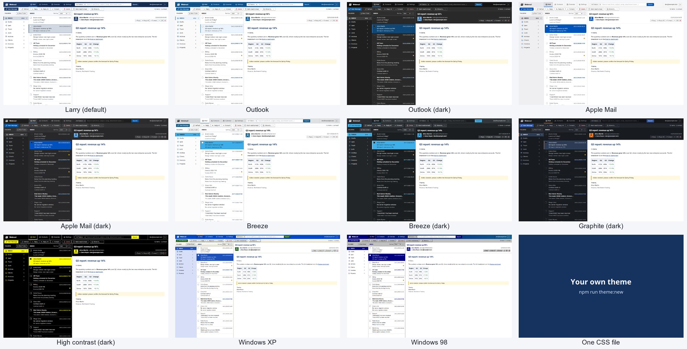
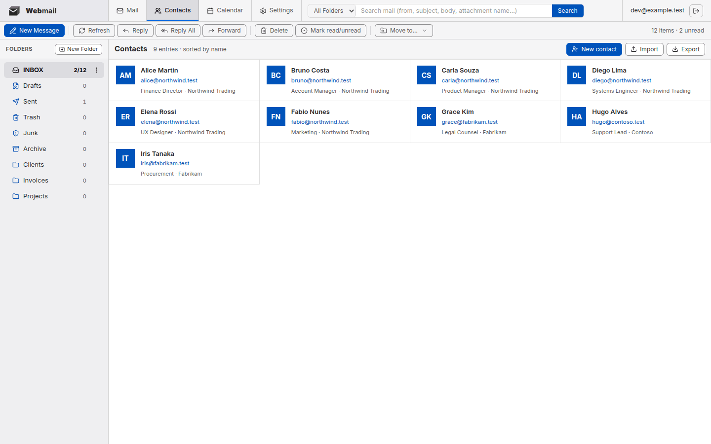

<p align="center">
  
</p>

# Go CubeMail

[](https://github.com/jniltinho/go-cubemail/releases)
[](https://github.com/jniltinho/go-cubemail/pkgs/container/go-cubemail)
[](https://go.dev/)
[](./LICENSE)
[](https://github.com/jniltinho/go-cubemail/stargazers)

**The webmail your mail server is missing.** One small binary gives your users a modern inbox, a calendar and an
address book, and keeps all three in sync with their phones and desktop clients. Nothing to migrate: it talks to the
IMAP and SMTP server you already run, and your messages never leave it.

## Why Go CubeMail

- **Keep your mail server.** Works with any IMAP/SMTP server; nothing to migrate, no second copy of the mail.
- **One binary.** The interface is compiled into the Go executable: no PHP, no Node.js, no separate web server.
- **Syncs with every device.** Built-in CalDAV, CardDAV and Exchange ActiveSync for calendars and contacts.
- **A look for everyone.** Eleven themes, all at WCAG AAA contrast; each user picks their own.
- **Private by design.** Mail stays on your server; the database holds only contacts, calendars and settings.
- **Free and open.** MIT licensed, with a documented REST API.

## Quick start

**Docker**

```bash
docker run -d --name go-cubemail -p 8080:8080 \
  -e GORC_SERVER_SECRET_KEY="$(openssl rand -base64 24)" \
  -e GORC_IMAP_HOST=mail.example.com \
  -e GORC_SMTP_HOST=mail.example.com \
  -v go-cubemail-data:/data \
  ghcr.io/jniltinho/go-cubemail:latest
```

**Binary** (Linux amd64, from the [Releases page](https://github.com/jniltinho/go-cubemail/releases))

```bash
tar -xzf go-cubemail_*.tar.gz
./go-cubemail init -o config.toml    # then set your IMAP and SMTP hosts in config.toml
./go-cubemail migrate
./go-cubemail serve
```

Open http://localhost:8080 and sign in with a mailbox of that server.

Building from source, environment variables, MariaDB/PostgreSQL, systemd and upgrading are covered in the
[installation guide](DOCUMENTS/README.md#installation).

## Eleven themes, one click

Each user chooses a theme in **Settings → Appearance**; it applies at once and follows them to any browser. The
administrator sets the default.



Every theme is held to **WCAG AAA** contrast by automated tests, and adding one is a single command and a single CSS
file. See the [Themes guide](DOCUMENTS/docs/THEMES.md) and the [full-size screenshots](DOCUMENTS/screenshots/themes).

## A closer look

| Rich-text composer | Contacts |
|--------------------|----------|
|  |  |

| Calendar | Pick your theme |
|----------|-----------------|
|  |  |

## Documentation

- **[Full documentation](DOCUMENTS/README.md)**: features in detail, installation, configuration, tech stack
- [Production Setup Guide](DOCUMENTS/setup/README.md): Ubuntu, MariaDB and systemd
- [DAV & Sync Setup](DOCUMENTS/docs/DAV_AND_SYNC_SETUP.md): CalDAV, CardDAV and ActiveSync, with client setup
- [Themes](DOCUMENTS/docs/THEMES.md): the shipped themes and how to add one
- [Development](DOCUMENTS/docs/DEVELOPMENT.md) and [Contributing](DOCUMENTS/docs/CONTRIBUTING.md)

## License

This project is licensed under the MIT License — see the [LICENSE](LICENSE) file for details.

## Contributing

Contributions are welcome. Please read:

- [Contributing Guide](DOCUMENTS/docs/CONTRIBUTING.md)
- [Development Guide](DOCUMENTS/docs/DEVELOPMENT.md)

All code, comments and documentation must be in English (see [English Only Policy](DOCUMENTS/specs/english_only.md)).

Found a bug or have an idea? [Open an issue](https://github.com/jniltinho/go-cubemail/issues).
