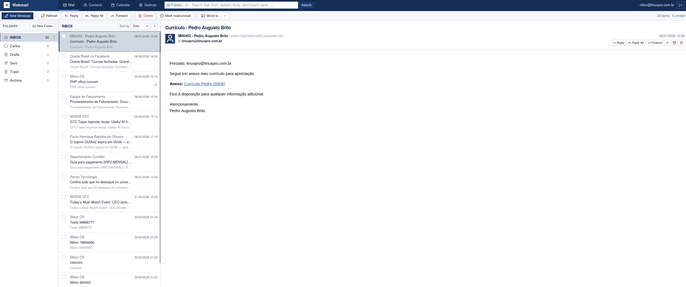
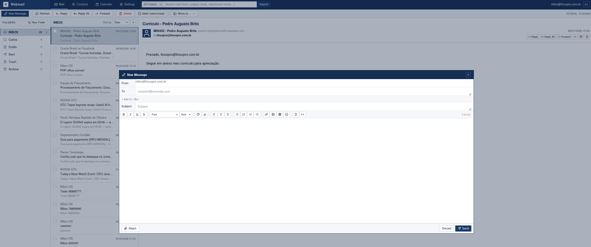
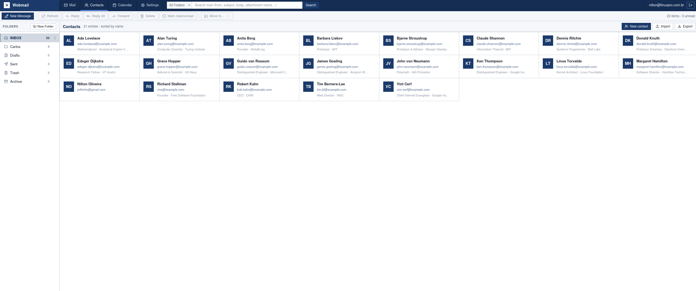
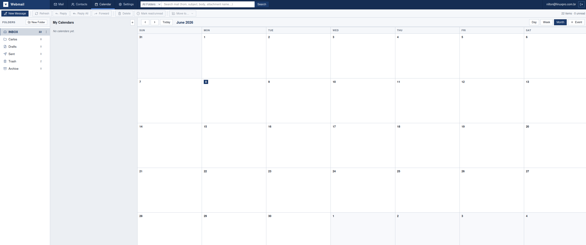

# Go CubeMail

[](https://go.dev/)
[](./LICENSE)
[](https://github.com/jniltinho/go-cubemail/releases)
[](https://github.com/jniltinho/go-cubemail/stargazers)

**Modern self-hosted webmail with calendar and contacts — works with your existing mail server.**

A single Go binary with the entire Vue 3 frontend embedded. Connects directly to your IMAP/SMTP server and exposes full CalDAV, CardDAV and Exchange ActiveSync (EAS) servers so calendars and contacts sync natively with Apple Calendar, Outlook, Thunderbird, iOS, Android and more.

No email migration. No data duplication. Your messages stay on your IMAP server.

Built with a modern Vue 3 + Go stack, inspired by the classic Roundcube "Larry" theme.

## Quick Start

### Pre-built release (recommended)

1. Download the latest Linux (amd64) binary from the [Releases page](https://github.com/jniltinho/go-cubemail/releases)
2. Extract and generate a config file:

   ```bash
   tar -xzf go-cubemail_*.tar.gz
   ./go-cubemail init -o config.toml
   ```

3. Edit `config.toml` with your IMAP/SMTP server details — without it the server
   starts against the built-in defaults and will not reach your mail server.
4. Create the database schema and start:

   ```bash
   ./go-cubemail migrate
   ./go-cubemail serve
   ```

5. Open http://localhost:8080

Pre-built binaries are published on every release. For production setup with MariaDB + systemd, see the [Production Setup Guide](DOCUMENTS/setup/README.md).

### Docker

Multi-arch images (amd64, arm64) are published to the GitHub Container Registry:
`latest` and `X.Y.Z` on every release, `edge` from `main`.

```bash
docker run -d --name go-cubemail -p 8080:8080 \
  -e GORC_SERVER_SECRET_KEY="$(openssl rand -base64 24)" \
  -e GORC_IMAP_HOST=mail.example.com \
  -e GORC_SMTP_HOST=mail.example.com \
  -v go-cubemail-data:/data \
  ghcr.io/jniltinho/go-cubemail:latest
```

- The container runs `migrate` and then `serve`, as an unprivileged user (uid 10001).
- `/data` holds the SQLite database. With a bind mount instead of a named volume,
  make the directory writable for uid 10001.
- `GORC_SERVER_SECRET_KEY` is required and must stay the same across restarts:
  it encrypts the IMAP password kept in the session, so changing it logs everyone out.
- Any other setting is a `GORC_` variable (`GORC_SMTP_PORT`, `GORC_DATABASE_DRIVER`,
  `GORC_DATABASE_DSN`, …), or mount a full config file at `/etc/go-cubemail/config.toml`.

### Build from source

Requires Go 1.26+ and Node.js (build time only).

```bash
git clone https://github.com/jniltinho/go-cubemail.git
cd go-cubemail

make all                            # builds Vue 3 frontend + embeds into Go binary
./bin/go-cubemail init -o config.toml   # then edit config.toml
./bin/go-cubemail migrate
./bin/go-cubemail serve
```

Access at http://localhost:8080.

Swagger UI (when enabled): `http://localhost:8080/swagger/`.

### Upgrading

Replace the binary and run the migration again before starting the new version:

```bash
./go-cubemail migrate
```

Migrations are idempotent, so running them when nothing changed is harmless. A release that adds a column (the
user's theme, for example) needs it: without the migration the settings endpoints fail.

## Screenshots

| Webmail — 3-column Larry-style interface | Composer with rich text |
|------------------------------------------|-------------------------|
|  |  |

| Contacts management | Calendar view |
|---------------------|---------------|
|  |  |

More screenshots in [DOCUMENTS/screenshots](DOCUMENTS/screenshots).

## Key Features

- **Works with your existing mail server** — No migration. Uses standard IMAP + SMTP. Supports any IMAP-compatible server (Dovecot, Cyrus, Exchange IMAP, etc.).
- **Single binary deployment** — Vue 3 frontend is compiled and embedded. One executable, no separate web server or Node.js at runtime.
- **Real groupware, not just webmail**:
  - Full webmail (3-column UI, rich-text composer, drag & drop, search, keyboard shortcuts)
  - Calendar with recurring events (month/week/day views in UI + full CalDAV backend)
  - Contacts with import/export (CSV + vCard via CardDAV)
- **Native sync for all your devices**:
  - **CalDAV** — Apple Calendar, Thunderbird (TbSync), Evolution, GNOME Calendar
  - **CardDAV** — Apple Contacts, Thunderbird, Evolution
  - **ActiveSync (EAS)** — iOS Mail/Calendar, Android (Outlook/Gmail), Outlook desktop (mail + calendar + contacts)
  - Every calendar and address book syncs as its own folder, over both DAV and ActiveSync — create one in Thunderbird and it appears on the phone
  - Delta sync: clients fetch only what changed, deletions included, and a conflicting edit is refused instead of silently overwriting
  - What a client sends is what it gets back — addresses, photos, birthdays, alarms and custom fields are never dropped in a round trip
- **Web Push notifications** — Real-time new mail alerts in the browser even when the tab is in the background (requires HTTPS + VAPID keys).
- **Privacy by design** — Your emails never leave your IMAP server. The database only stores contacts, calendar events, identities, settings and sessions.
- **Themes** — Ten looks, each user picks their own: Larry (default), Outlook and Apple Mail inspired (light and dark), Breeze (light and dark), Graphite, High contrast and Windows XP. All meet WCAG AAA contrast; a new theme is one CSS file (`npm run theme:new`). See [Themes](DOCUMENTS/docs/THEMES.md).
- **Full HD, QHD and 4K** — The interface scales up on wide monitors instead of leaving small text.
- **Multiple identities & signatures** — Send from different addresses with per-identity signatures.
- **Easy to operate** — `init` generates a ready-to-use config, migrations are a single idempotent command. Production examples with systemd + MariaDB/PostgreSQL included.
- **Production API** — Versioned REST API with Swagger documentation. Useful for automation and integrations.
- **CLI tools** — `init`, `migrate`, `serve`, `version`.

## Documentation

- [Production Setup Guide](DOCUMENTS/setup/README.md) — Ubuntu + MariaDB + systemd deployment (recommended for production)
- [DAV & Sync Setup](DOCUMENTS/docs/DAV_AND_SYNC_SETUP.md) — CalDAV, CardDAV and ActiveSync configuration + client setup (Thunderbird, iOS, Outlook, Android)
- [CalDAV & CardDAV Implementation](DOCUMENTS/docs/DAV_IMPLEMENTATION.md) — DAV server architecture, design rationale and roadmap
- [Development Guide](DOCUMENTS/docs/DEVELOPMENT.md) — Local development with hot reload
- [Contributing Guide](DOCUMENTS/docs/CONTRIBUTING.md)
- Full API reference via Swagger UI (enable `swagger_enable = true` in config)

## Tech Stack

**Backend**: Go 1.26, Echo v5, GORM, Cobra, Viper, Swaggo (OpenAPI)

**Frontend (embedded)**: Vue 3 + TypeScript + Vite+ (`vp`), Pinia, Tailwind CSS v4, TipTap (rich text), Lucide icons

**Email & Sync**:
- IMAP: `emersion/go-imap/v2`
- SMTP: `wneessen/go-mail`
- CalDAV / CardDAV: custom implementation (RFC 4791 / 6352, with RFC 6578 delta sync)
- ActiveSync (EAS): `remdev/go-activesync` + custom command handlers
- iCalendar (RRULE, VEVENT): custom parser + recurrence engine

**Packaging**: Single binary with embedded SPA, UPX compression support, systemd unit example

## Configuration

The easiest way to start:

```bash
./go-cubemail init -o config.toml
```

Then fill in your IMAP/SMTP and database details. Without `-o`, the file is
named `config_<timestamp>.toml` so an existing config is never overwritten —
rename it to `config.toml` before starting the server.

The config file is looked up as `./config.toml`, then `/etc/go-cubemail/config.toml`,
or wherever `--config` points. All settings can be overridden with `GORC_`
environment variables.

See the [Production Setup Guide](DOCUMENTS/setup/README.md) for MariaDB/PostgreSQL + systemd examples.

## License

This project is licensed under the MIT License — see the [LICENSE](LICENSE) file for details.

## Contributing

Contributions are welcome. Please read:

- [Contributing Guide](DOCUMENTS/docs/CONTRIBUTING.md)
- [Development Guide](DOCUMENTS/docs/DEVELOPMENT.md)

All code, comments and documentation must be in English (see [English Only Policy](DOCUMENTS/specs/english_only.md)).

Found a bug or have an idea? [Open an issue](https://github.com/jniltinho/go-cubemail/issues).
